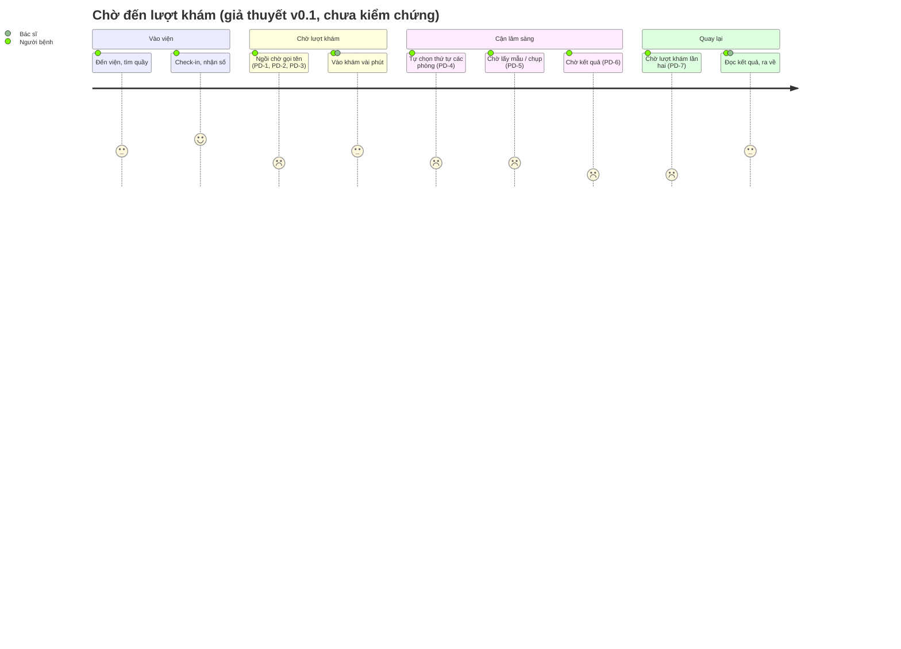
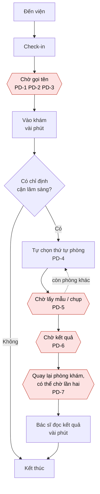

# 02 – Journey map: chờ đến lượt khám

Khoảnh khắc đã chọn: **chờ đến lượt khám**, từ lúc check-in xong đến lúc được gọi vào phòng, gồm cả quãng chờ lấy mẫu/chụp chiếu, chờ kết quả rồi quay lại phòng khám.

Trạng thái: **v0.1 (nháp trước phỏng vấn)**. Khung các bước dựa trên quan sát khu khám ngoại trú ở một bệnh viện công khi làm CarePath (7/2026). Mọi chỗ cần dữ liệu từ P1–P3 hoặc từ việc dùng thử MyVinmec được đánh dấu `> [CẬP NHẬT SAU PHỎNG VẤN]`. Không có lời thoại hay con số nào trong file này được bịa.

## 1. Cách đọc

- **Cảm xúc** (thang 4 mức): 😊 ổn / yên tâm · 😐 trung tính, sốt ruột nhẹ · 😟 lo, bứt rứt · 😡 bực, mất kiên nhẫn.
- **Điểm đau**: 🔴 kèm mã PD-n. Mã dùng lại ở `03-need-statement/bang-chung.md`.
- **Nguồn từng ô**: ô không có ghi chú là **giả thuyết từ quan sát CarePath, chờ kiểm chứng**. Cảm xúc ở mọi bước hiện là **dự đoán**, chưa phải dữ liệu; sẽ thay bằng cảm xúc P1–P3 kể lại.
- "Thông tin CÓ" = người bệnh biết gì ở bước đó; "THIẾU" = điều họ cần mà không có.

## 2. Bảng journey map

| # | Bước | Hành động | Suy nghĩ (giả thuyết) | Cảm xúc (dự đoán) | Thông tin CÓ | Thông tin THIẾU | Điểm đau |
|---|---|---|---|---|---|---|---|
| 1 | Đến viện | Đến nơi, tìm quầy/khu tiếp đón, lấy hoặc xác nhận lịch hẹn | "Không biết hôm nay đông không, mình đến vậy có kịp không" | 😐 | Giờ hẹn (nếu có đặt), tên khoa/phòng | Mức đông hiện tại; mình sẽ ở viện khoảng bao lâu | Không nằm trong phạm vi chính, ghi nhận để so sánh |
| 2 | Check-in | Xuất trình thông tin/quét mã, nhận số thứ tự hoặc xác nhận đã tới | "Xong rồi, giờ chắc được gọi sớm" | 😊 | Đã vào hàng; có số thứ tự hoặc xác nhận | Còn bao nhiêu người trước mình; ước tính bao lâu thì tới lượt | 🔴 **PD-1** Sau check-in không biết "mình đang ở đâu trong hàng" và "còn chờ bao lâu" |
| 3 | Ngồi chờ gọi tên | Ngồi/đứng gần cửa phòng, nghe loa, nhìn màn hình, hỏi điều dưỡng hoặc người ngồi cạnh | "Đừng bỏ lỡ lượt. Sao người đến sau lại vào trước?" | 😟 → 😡 | Số mình cầm; số đang gọi (nếu có màn hình/loa) | Lý do thứ tự đổi (ưu tiên người già, trẻ em, cấp cứu, thai phụ; ca bác sĩ gọi lại); phòng đang trễ vì sao | 🔴 **PD-2** Bị "trói" ở chỗ ngồi vì sợ lỡ lượt, không dám đi vệ sinh, ăn, nghỉ · 🔴 **PD-3** Thấy người khác vào trước mà không hiểu vì sao (cảm giác không công bằng) |
| 4 | Vào khám | Được gọi, trao đổi với bác sĩ vài phút | "Mong khám kỹ, nhưng cũng thấy mình đã chờ quá lâu" | 😐 | Bác sĩ nói gì, chỉ định gì | Bước tiếp theo đi đâu, trình tự thế nào, đại khái mất bao lâu | Quan sát CarePath: đây là phần ngắn nhất của cả chuyến (vài phút). Không phải điểm đau chính |
| 5 | Được chỉ định cận lâm sàng | Nhận chỉ định xét nghiệm/chụp chiếu, tự quyết thứ tự đi các phòng | "Đi phòng nào trước cho nhanh? Chắc phòng gần nhất" | 😟 | Danh sách phòng cần đi, vị trí phòng | Phòng nào đang đông, thứ tự nào ít chờ nhất; mỗi nơi chờ khoảng bao lâu | 🔴 **PD-4** Phải tự chọn thứ tự mà không có thông tin tải của từng phòng, nên nhiều người cùng dồn vào một chỗ (quan sát CarePath: tự chọn thứ tự, dồn cục) |
| 6 | Chờ lấy mẫu / chụp | Xếp hàng ở phòng xét nghiệm hoặc chẩn đoán hình ảnh | "Lại một hàng nữa. Không biết có bị nhầm hàng không" | 😟 | Số/thứ tự ở phòng đó (nếu có) | Có đang đúng hàng không; trước mình còn bao nhiêu; chuẩn bị gì (nhịn ăn, đủ nước...) đã đủ chưa | 🔴 **PD-5** Mỗi phòng là một hàng riêng, người bệnh mất hình dung tổng thể "chuyến đi này còn bao nhiêu chặng" |
| 7 | Chờ kết quả | Ngồi chờ hoặc đi lại quanh khu; hỏi quầy; mở app (nếu có) | "Kết quả xong chưa? Hỏi thì sợ phiền, không hỏi thì sợ lỡ" | 😡 | Có thể biết kết quả sẽ trả qua kênh nào (tùy bệnh viện) | Kết quả đã ra chưa; còn bao lâu; ai báo mình khi xong | 🔴 **PD-6** Chờ kết quả "mù": không biết đã xong chưa, đang chờ cái gì (quan sát CarePath: phần lớn thời gian mất ở chờ máy và chờ kết quả) |
| 8 | Quay lại phòng khám | Cầm kết quả/chờ kết quả đẩy lên hệ thống, quay lại phòng, có thể phải chờ lượt lần nữa | "Mình đã xong hết rồi, sao còn phải xếp hàng lại?" | 😡 | Có kết quả (hoặc đang chờ); biết cần quay lại | Quay lại thì xếp ở đâu, có được ưu tiên vì đã chờ lâu không; bác sĩ có thấy kết quả chưa | 🔴 **PD-7** Quay lại phòng khám không rõ vị trí trong hàng, có thể phải chờ lượt lần hai |
| 9 | Kết thúc | Bác sĩ đọc kết quả (vài phút), nhận hướng dẫn, ra về | "Cuối cùng cũng xong, mất cả buổi" | 😐 | Kết luận/hướng dẫn tiếp theo | Tổng thời gian đã mất đi đâu (mình không có bức tranh này) | Ghi nhận cảm xúc "mất cả buổi" cho phần tổng hợp; chưa gắn PD riêng |

> [CẬP NHẬT SAU PHỎNG VẤN] Thay cột "Suy nghĩ" và "Cảm xúc" bằng điều P1–P3 kể lại; thêm cột "Thời gian thực tế (phút)" cho từng bước; bổ sung hoặc gộp PD khi dữ liệu cho thấy điểm đau không tồn tại hoặc có điểm đau mới.

> [CẬP NHẬT SAU PHỎNG VẤN] Bước nào trong 9 bước trên P1–P3 không trải qua (ví dụ khám không cần cận lâm sàng) thì ghi rõ để không suy diễn thành "đường đi chung".

## 3. Phụ lục: ô cần đo thời gian (khung, chưa có số)

| Bước | Thời gian thực tế (phút) | Nguồn |
|---|---|---|
| 2 → 3: check-in đến được gọi vào khám lần 1 | ___ (đo từ phỏng vấn) | P1–P3 |
| 4: thời gian trong phòng khám lần 1 | ___ | P1–P3 / quan sát CarePath: vài phút |
| 5 → 6: từ ra khỏi phòng khám đến bắt đầu lấy mẫu/chụp | ___ | P1–P3 |
| 6 → 7: chờ kết quả | ___ | P1–P3 |
| 8: từ có kết quả đến được gọi lại vào phòng | ___ | P1–P3 |
| Tổng thời gian từ check-in đến ra về | ___ | P1–P3 |

## 4. Sơ đồ minh hoạ

Sơ đồ journey (điểm cảm xúc 1–5 là **dự đoán** theo thang 😡=1 ... 😊=5, chờ thay bằng dữ liệu P1–P3):

Sơ đồ luồng cho thấy các vòng chờ lặp lại (chờ - đi - chờ - quay lại - chờ):

Các ô tô đỏ là các quãng chờ. Theo quan sát CarePath, hai bước có người bệnh trực tiếp "làm việc" (D và K) đều rất ngắn so với bốn quãng chờ.

## 5. Giả thuyết vấn đề: vì sao quãng chờ gây khó chịu?

Theo Day 17: cùng một hành vi (người bệnh bực bội khi chờ) có nhiều cách giải thích, mỗi cách dẫn tới một hướng xử lý khác nhau. Chưa giả thuyết nào được xem là đúng. Mục đích của phỏng vấn P1–P3 là **phân xử**, không phải bảo vệ giả thuyết nào.

### H1. Chờ lâu tuyệt đối (độ dài thời gian chờ)

- **Nội dung:** khó chịu vì tổng thời gian chờ dài, bất kể có biết gì hay không. Nếu rút ngắn thì hết khó chịu.
- **Bằng chứng hiện có:** quan sát CarePath cho thấy phần lớn thời gian ở viện là chờ đến lượt và chờ kết quả, còn khám và đọc kết quả chỉ vài phút. Báo chí và trang bệnh viện nói chung là "đông, chờ lâu". Đây là bằng chứng cho việc *chờ chiếm phần lớn thời gian*, **chưa** phải bằng chứng cho việc *độ dài là nguyên nhân gây khó chịu*.
- **Cần bằng chứng gì từ phỏng vấn để phân xử:** (a) có lần nào chờ rất lâu mà người đó vẫn thấy ổn, và lần nào chờ không lâu mà vẫn bực? Điều gì khác nhau giữa hai lần? (b) khi nói "lâu", họ so với cái gì (so với hẹn, so với lần trước, so với người khác)? (c) mức chờ nào họ kể là "chấp nhận được"?
- **Nếu H1 đúng:** hướng xử lý tập trung vào giảm thời gian (điều phối, năng lực), không phải thông tin.

### H2. Mù thông tin / chờ không giải thích được (unexplained wait)

- **Nội dung:** khó chịu chủ yếu vì không biết mình đang ở đâu trong hàng, còn chờ bao lâu, đang chờ cái gì. Chờ có thông tin dễ chịu hơn chờ không thông tin.
- **Bằng chứng hiện có:** (a) quan sát CarePath: người bệnh tự chọn thứ tự đi các phòng mà không có thông tin tải của từng phòng, dẫn tới dồn cục, tức là *thông tin là thứ thiếu thật*. (b) ghi chép dùng thử MyVinmec: `> [CẬP NHẬT SAU PHỎNG VẤN]` (chưa điền; cần ghi app hiện hiển thị gì về hàng chờ). Đây là giả thuyết đang được dùng để dựng need statement v0.1, nên cần kiểm chứng kỹ nhất.
- **Cần bằng chứng gì từ phỏng vấn để phân xử:** (a) lần chờ gần nhất, họ biết gì và không biết gì lúc đó? (b) họ đã làm gì để có thêm thông tin (hỏi điều dưỡng, hỏi người ngồi cạnh, đi dò phòng)? Đó là workaround. (c) nếu có người nói rõ "còn khoảng bao lâu" thì họ thấy khác thế nào, kể bằng ví dụ thật chứ không phải câu hỏi giả định "bạn có muốn biết không".
- **Nếu H2 đúng:** nhu cầu nằm ở sự bất định, không chỉ ở độ dài. Hướng xử lý có thể rất khác nhau (thông báo, bảng hiển thị, người hướng dẫn...), cần chọn sau.

### H3. Sợ lỡ lượt nên bị trói vào ghế

- **Nội dung:** điều gây khó chịu không phải thời gian mà là không dám rời chỗ (đi vệ sinh, ăn, nghe điện thoại, nghỉ ngơi) vì sợ bị gọi mà không có mặt và mất lượt.
- **Bằng chứng hiện có:** chưa có bằng chứng trực tiếp. Suy ra từ cơ chế gọi tên/loa ở khu khám ngoại trú; **thuần giả thuyết**.
- **Cần bằng chứng gì từ phỏng vấn để phân xử:** (a) họ có rời chỗ lần nào trong lúc chờ không, và điều gì xảy ra (bị lỡ không, ai báo)? (b) nếu không rời, vì sao không rời? (c) từng ai bị gọi mà vắng chưa, hậu quả ra sao (bị xếp lại cuối, bị bỏ qua)? Hỏi về sự kiện thật, không hỏi "bạn có sợ lỡ lượt không".
- **Nếu H3 đúng:** nhu cầu nằm ở sự an tâm khi rời chỗ trong lúc chờ; giảm độ dài không giải quyết được nếu người ta vẫn sợ rời chỗ.

### H4. Công bằng: thấy người đến sau vào trước

- **Nội dung:** khó chịu vì thứ tự gọi trông như "không theo quy tắc", trong khi thực tế có thể là hợp lý (ưu tiên người già, trẻ em, cấp cứu, thai phụ, ca được bác sĩ gọi lại).
- **Bằng chứng hiện có:** quan sát CarePath và phỏng vấn người điều phối cho biết có các nhóm ưu tiên thật, nên thứ tự gọi *thực sự không phải* theo giờ đến. Nhưng việc *người bệnh nhìn thấy và bực vì điều đó* thì **chưa có bằng chứng**.
- **Cần bằng chứng gì từ phỏng vấn để phân xử:** (a) có lần nào họ thấy người đến sau được gọi trước, họ nghĩ gì và làm gì (hỏi lại, tự giải thích, bỏ qua)? (b) sau khi biết lý do (nếu từng biết) họ thấy khác không? (c) họ có tự nghĩ thứ tự đó là hợp lý khi được giải thích không?
- **Nếu H4 đúng:** vấn đề là niềm tin vào tính công bằng của thứ tự, nên cần cho người bệnh hiểu quy tắc, không nhất thiết rút ngắn chờ.

### H5 (dự phòng). Hiểu "đang chờ cái gì" (nhầm hàng)

- Có thể người bệnh không chắc mình đang chờ đúng thứ (kết quả hay lượt gọi lại). Chỉ giữ nếu P1–P3 kể ra; nếu không có thì bỏ.

### Bảng tóm tắt để phân xử sau phỏng vấn

| Giả thuyết | Bằng chứng hiện có | Mức tin hiện tại | Câu hỏi phân xử then chốt | Kết quả P1–P3 |
|---|---|---|---|---|
| H1 Chờ lâu tuyệt đối | Chờ chiếm phần lớn thời gian (CarePath) | Trung bình (đúng về thời lượng, chưa rõ về cảm xúc) | Chờ lâu nhưng vẫn ổn khi nào? | `> [CẬP NHẬT SAU PHỎNG VẤN]` |
| H2 Mù thông tin | Thiếu thông tin tải phòng, dồn cục (CarePath); MyVinmec chưa ghi | Trung bình (cần xác nhận từ phía người bệnh) | Lúc chờ họ biết gì, thiếu gì, đã làm gì để biết thêm? | `> [CẬP NHẬT SAU PHỎNG VẤN]` |
| H3 Sợ lỡ lượt | Không có | Thấp | Có rời chỗ không, vì sao? | `> [CẬP NHẬT SAU PHỎNG VẤN]` |
| H4 Công bằng | Có nhóm ưu tiên thật; chưa rõ người bệnh có nhận ra | Thấp | Thấy người sau vào trước thì nghĩ gì, làm gì? | `> [CẬP NHẬT SAU PHỎNG VẤN]` |

Lưu ý: các giả thuyết **không loại trừ nhau**. Một người có thể vừa lo lỡ lượt (H3) vừa thấy thiếu thông tin (H2). Sau phỏng vấn cần ghi giả thuyết nào xuất hiện ở bao nhiêu trong 3 người, và xuất hiện qua sự kiện cụ thể hay chỉ qua ý kiến chung.

## 6. Ghi chú nguồn

| Phần | Nguồn | Mức |
|---|---|---|
| Chuỗi các bước 1–9 | Khung quan sát khu khám ngoại trú ở một bệnh viện công khi làm CarePath (7/2026), người quan sát là tác giả | Quan sát, chưa kiểm chứng ở bối cảnh Vinmec |
| "Khám và đọc kết quả chỉ vài phút; phần lớn thời gian là chờ đến lượt và chờ kết quả" | Quan sát CarePath 7/2026, đối chiếu qua tin nhắn với một người điều phối lịch ở bệnh viện công | Bằng chứng sơ khởi, một người, một lần |
| "Người bệnh tự chọn thứ tự đi các phòng nên dồn cục" (PD-4) | Quan sát CarePath 7/2026 | Bằng chứng sơ khởi |
| Nhóm ưu tiên (người già, trẻ em, cấp cứu, thai phụ) (PD-3) | Phỏng vấn người điều phối, CarePath 7/2026 | Bằng chứng sơ khởi |
| Cột "Suy nghĩ", "Cảm xúc" và các PD-1, PD-2, PD-5, PD-6, PD-7 | Giả thuyết của tác giả suy ra từ quan sát | **Chờ kiểm chứng bằng P1–P3** |
| H1–H4 | Giả thuyết cạnh tranh theo Day 17 | **Chờ phân xử bằng P1–P3** |
| App MyVinmec hiện hiển thị gì về hàng chờ | Chưa có | `> [CẬP NHẬT SAU PHỎNG VẤN]` (điền từ `01-phong-van/ghi-chep-myvinmec.md`) |

Lưu ý: bối cảnh quan sát là một bệnh viện công, không phải Vinmec. Quy trình, mật độ, cách gọi số của Vinmec có thể khác; mọi bước phải được kiểm tra lại với người đi khám (bất kỳ cơ sở nào) trước khi coi là đúng.

Phần do AI hỗ trợ: AI giúp soạn cấu trúc bảng và sơ đồ mermaid; nội dung giả thuyết do tác giả cung cấp từ quan sát và được AI diễn đạt lại. AI không tạo dữ liệu hay trích dẫn.
