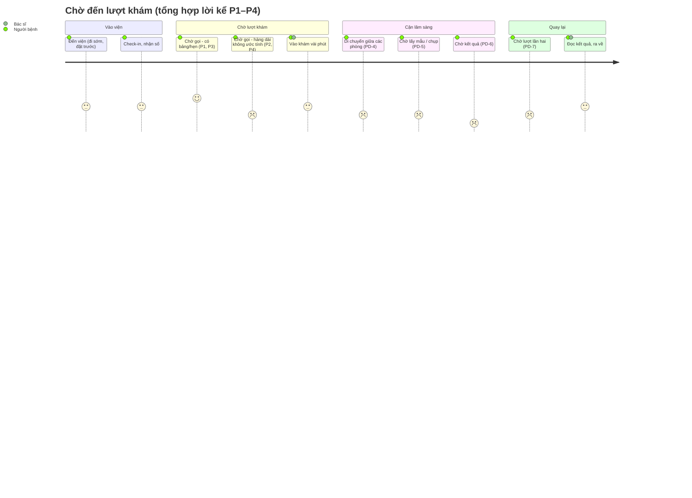
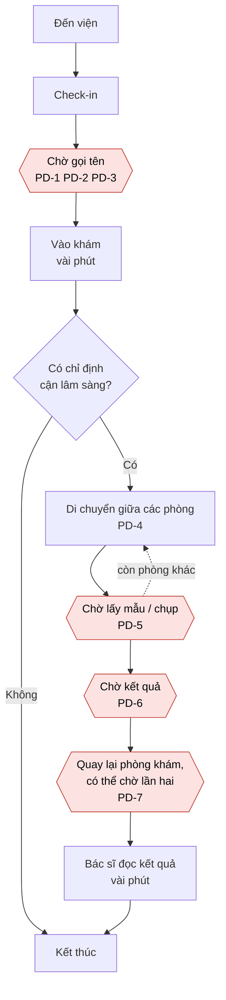

# 02 – Journey map: chờ đến lượt khám

Khoảnh khắc đã chọn: **chờ đến lượt khám**, từ lúc check-in xong đến lúc được gọi vào phòng, gồm cả quãng chờ lấy mẫu/chụp chiếu, chờ kết quả rồi quay lại phòng khám.

Khung các bước được dựng từ quan sát khu khám ngoại trú ở một bệnh viện công khi làm CarePath (7/2026), sau đó đối chiếu và cập nhật bằng 4 cuộc phỏng vấn P1–P4 (`01-phong-van/`) và ghi chép dùng thử MyVinmec. Không có lời thoại hay con số nào trong file này được bịa; ô nào không có dữ liệu thì ghi rõ "không có dữ liệu".

## 1. Cách đọc

- **Cảm xúc** (thang 4 mức): 😊 ổn / yên tâm · 😐 trung tính, sốt ruột nhẹ · 😟 lo, bứt rứt · 😡 bực, mất kiên nhẫn. Cảm xúc ghi theo lời kể của P1–P4 (có dẫn nguồn); mức độ phụ thuộc bối cảnh nên nhiều ô ghi hai trạng thái kèm điều kiện.
- **Điểm đau**: 🔴 kèm mã PD-n. Mã dùng lại ở `03-need-statement/bang-chung.md`.
- Trích nguồn dạng `P4 §3#8` = file P4.md, mục 3, dòng 8.
- "Thông tin CÓ" = người bệnh biết gì ở bước đó; "THIẾU" = điều họ cần mà không có.

## 2. Bảng journey map (sau 4 cuộc phỏng vấn)

| # | Bước | Hành động | Người bệnh kể gì | Cảm xúc | Thông tin CÓ | Thông tin THIẾU | Điểm đau |
|---|---|---|---|---|---|---|---|
| 1 | Đến viện | Đến nơi, tìm quầy/khu tiếp đón | P1: đến sớm ~15' theo tin nhắn hẹn. P4: chủ động đến từ 6:00 vì "7:00 đến không có chỗ mà để ngồi", đặt số trước 3–4 ngày (`P4 §3#1,14`) | 😐 | Giờ hẹn (nếu đặt), tên khoa | Mức đông hiện tại; hôm nay sẽ mất khoảng bao lâu | Đệm thời gian (đi sớm, đặt trước) là chi phí mặc định cả 4 người đều trả — ghi nhận, không gắn PD riêng |
| 2 | Check-in / lấy số | Xuất trình giấy tờ, lấy số hoặc xác nhận đã tới | P2 (tư): ~15' xử lý hồ sơ. P4 (công): ~20' gồm "thời gian không biết phải hỏi ai để lấy số" (`P4 §3#2`). P2 (công): nhận số ~800 khi bảng mới ~400, không ai ước tính (`P2 §3#15`) | 😊 khi có hẹn → 😟 khi hàng dài không ước tính | Đã vào hàng; số của mình | Còn bao nhiêu người trước mình; ước tính bao lâu tới lượt | 🔴 **PD-1** Sau check-in không biết "mình đang ở đâu trong hàng, còn bao lâu" — ĐAU RÕ ở hàng dài viện công (P2, P4); gần trung tính khi có lịch hẹn (P1) hoặc bảng số + khung giờ dự kiến (P3) |
| 3 | Ngồi chờ gọi khám | Ngồi gần cửa, nhìn bảng/nghe gọi tên, bấm điện thoại | P1: ~10', đọc về bác sĩ. P2: ~10', liếc phòng ~5'/lần, "ô sao lâu thế nhỉ". P3: ~30', ngước bảng ~15'/lần, tự trừ số: "số mười tám mà mình số hai hai thì biết còn bốn người" (`P3 §4#1`). P4: ~45', "có số điện tử nhưng vẫn có người gọi" (`P4 §3#3`) | 😊–😐 khi có bảng/quy tắc rõ; 😟 khi không | Số mình cầm; số đang gọi (nơi có bảng) | Lý do khi thứ tự đổi; phòng đang trễ vì sao | 🔴 **PD-2** Bị "trói" vào ghế: CHỈ xuất hiện khi không có điều phối (P4 quãng chờ kết quả — xem bước 7); P1 (người nhà giữ chỗ + viện gọi), P2 (biết luật đẩy số), P3 (có bảng, chờ ngắn) đều rời chỗ được · 🔴 **PD-3** Không công bằng: 1 ca đậm — P4 khó chịu nhất vì người chen hàng; P2 thấy người sau vào trước nhưng hiểu lý do nên không bực |
| 4 | Vào khám | Trao đổi với bác sĩ | P3: ~5'. P4: ~10'. Khớp quan sát CarePath: phần ngắn nhất của cả chuyến | 😐 | Chỉ định của bác sĩ | Bước tiếp theo mất khoảng bao lâu | Không phải điểm đau chính (4/4 không ai phàn nàn bước này) |
| 5 | Được chỉ định cận lâm sàng | Đóng tiền, đi tới các phòng xét nghiệm/chụp | P1: theo hướng dẫn tới phòng xét nghiệm. P4: máy nội soi tòa này đông, ~20' sau có người điều hướng sang tòa khác; "điều phối giữa các máy ở các vị trí khác nhau không được rõ ràng lắm" (`P4 §3#6`) | 😟 | Danh sách phòng cần đi | Phòng nào đang đông; thứ tự nào ít chờ nhất | 🔴 **PD-4** Chọn/được chuyển giữa các phòng mà không có thông tin tải: quan sát CarePath (tự chọn, dồn cục) + P4 (điều phối giữa máy không rõ ràng) |
| 6 | Chờ lấy mẫu / chụp | Xếp hàng tại phòng | P1: 10–15', "người đến trước được xn trước". P4: xét nghiệm máu 2 hàng ~15' "bình thường, đúng số"; nội soi đợi ~1,5 tiếng cho thủ thuật 5–7' (`P4 §3#5-6`) | 😐 khi "đúng số"; 😟 khi chờ máy dài | Hàng tại phòng đó | Trước mình còn bao nhiêu; vì sao lâu | 🔴 **PD-5** Mỗi phòng một hàng riêng, mất hình dung tổng thể; chờ máy dài không ước tính (P4 nội soi) |
| 7 | **Chờ kết quả** | Ngồi chờ hoặc rời đi; canh cửa phòng trả kết quả | P1: đi ăn, cà phê (viện gọi khi có kết quả) nhưng "chờ sốt ruột", muốn thấy kết quả sớm trên app — app chỉ cập nhật sau buổi khám (`P1 §4#1`). P4: **hơn 2 tiếng**, "không rõ đang đọc ở số nào", không có điều phối → nghe ngóng hỏi bệnh nhân khác, chỉ rời chỗ khi bắt buộc vì "sợ có người chen trước", suýt lỡ lượt (`P4 §3#7-11`) | 😟 → 😡 | Biết kết quả sẽ có (P1 còn được hẹn giờ quay lại) | Kết quả xong chưa; đang đọc đến số nào; ai gọi mình, khi nào | 🔴🔴 **PD-6** Chờ kết quả = quãng DÀI NHẤT và MÙ NHẤT của cả bộ dữ liệu: 2 ca trực tiếp (P1 trạng thái, P4 >2h không điều phối); đây là trọng tâm của need statement |
| 8 | Quay lại phòng khám | Chờ được gọi đọc kết quả | P1: có giờ hẹn quay lại. P4: gộp trong quãng chờ kết quả; tự nhận "may" vì kịp số cuối ca sáng, không thì đợi đến ~13:00 (`P4 §3#7`) | 😐 khi có hẹn; 😡 khi mù số | Biết cần quay lại | Vị trí trong hàng lần hai; bác sĩ thấy kết quả chưa | 🔴 **PD-7** Lượt chờ lần hai không rõ vị trí — trùng cơ chế với PD-6 |
| 9 | Kết thúc | Bác sĩ đọc kết quả, lấy thuốc, ra về | P4: tổng 6:00→12:00. P2 (tư): ~1 tiếng cả buổi. P3: ~45'. P1: sai lệch so dự tính <30' | 😐 | Kết luận, hướng dẫn | Tổng thời gian đã mất đi đâu | "Mất cả buổi" đúng với viện công tuyến cuối (P4, P2-công); KHÔNG đúng với nơi có hẹn/online (P1, P2-tư, P3) |

Đường đi của từng người: P1 trải bước 1–9 (xét nghiệm máu, không chụp trong buổi kể); P4 trải đủ 1–9 (xét nghiệm + nội soi); P2 lần gần nhất (tư) chỉ có 1–4 và 9 (tái khám, không cận lâm sàng — lần công tuyến cuối chỉ kể quãng chờ siêu âm); P3 chỉ có 1–4 và 9 (khám mắt, không cận lâm sàng). Vậy bước 5–8 có dữ liệu từ 2 người (P1, P4) — không suy diễn thành "đường đi chung" của cả 4.

## 3. Thời gian thực tế từ lời kể (đều là số người kể nhớ/dựng lại, không phải đo máy)

| Quãng | P1 (Vinmec, hẹn) | P2 (tư) | P2 (công, siêu âm) | P3 (PK mắt, online) | P4 (công tuyến cuối) |
|---|---|---|---|---|---|
| Check-in đến vào khám lần 1 | ~10' | ~15' hồ sơ + ~10' chờ khám | — | ~30' | ~20' lấy số + ~45' chờ |
| Trong phòng khám | không hỏi số | — | — | ~5' | ~10' |
| Chờ lấy mẫu / chụp | 10–15' (lấy máu); delay chụp 10–15' | — | ~6 tiếng cho một lượt siêu âm (8:00 lấy số → ~14:00) | — | ~15' (máu); ~1,5h (nội soi, thủ thuật 5–7') |
| **Chờ kết quả** | không có số (rời đi, viện gọi) | — | — | — | **>2 tiếng (9:30→11:45)** |
| Tổng cả buổi | sai lệch so dự tính <30' | ~1 tiếng | — | ~45' | ~6 tiếng (6:00→12:00) |

## 4. Sơ đồ minh hoạ

Điểm cảm xúc 1–5 là ước lệ hóa từ lời kể P1–P4 (😡=1 … 😊=5); hai kịch bản tách biệt rõ trong dữ liệu nên vẽ mức trung bình kèm chú thích:

Sơ đồ luồng cho thấy các vòng chờ lặp lại (chờ - đi - chờ - quay lại - chờ):

Các ô tô đỏ là các quãng chờ. Hai bước người bệnh trực tiếp "làm việc" (D và K) đều rất ngắn — vài phút (P3, P4) — so với các quãng chờ; riêng quãng chờ kết quả của P4 dài hơn 2 tiếng.

## 5. Bốn giả thuyết cạnh tranh và kết quả phân xử

Cùng một hành vi (khó chịu khi chờ) có nhiều cách giải thích, mỗi cách dẫn tới một hướng xử lý khác nhau, nên bốn giả thuyết được dựng TRƯỚC khi phỏng vấn và phân xử bằng sự kiện P1–P4 kể, không bảo vệ giả thuyết nào.

### H1. Chờ lâu tuyệt đối — YẾU

- **Nội dung:** khó chịu vì tổng thời gian chờ dài; rút ngắn thì hết khó chịu.
- **Kết quả:** độ dài có thật (P4: ~6 tiếng; P2 công: ~6 tiếng cho một lượt siêu âm) nhưng KHÔNG phải điều người kể bực nhất — thái độ là cam chịu: "người ta khám nhiều, nó lâu thì cũng phải đợi thôi, biết làm nào được" (P4). Chờ có giải thích/đúng quy tắc thì chấp nhận được kể cả dài (P1 delay chụp có lý do; P4 xét nghiệm máu "đúng số, bình thường").
- **Hệ quả:** không lấy "giảm thời gian chờ" làm trục need statement.

### H2. Mù thông tin / chờ không giải thích được — MẠNH NHẤT, trục của need statement

- **Nội dung:** khó chịu chủ yếu vì không biết mình đang ở đâu, còn bao lâu, đang chờ cái gì.
- **Kết quả:** 3/4 người kể sự kiện cụ thể kèm workaround: P2 (công) tự canh tốc độ mỗi ca siêu âm × số người để ước giờ quay lại; P1 mù trạng thái kết quả, "chờ sốt ruột"; P4 chờ kết quả >2h "không rõ đang đọc ở số nào", phải hỏi bệnh nhân khác. **P3 là đối chứng dương**: nơi có bảng hiện số đang khám + khung giờ dự kiến khi đặt online, người thường tự định vị được "còn 4 người" và yên tâm — chỉ cần thông tin tối thiểu là trải nghiệm đổi hẳn. Ghi chép MyVinmec: app hiện KHÔNG có chức năng nào cho "trong buổi khám" (check-in, số thứ tự, trạng thái kết quả) → khoảng trống H2 chưa được lấp tại Vinmec.
- **Hai dạng của H2 trong dữ liệu:** (a) vị trí trong hàng khi không có điều phối/ước tính; (b) trạng thái kết quả cận lâm sàng — dạng (b) rơi đúng quãng dài nhất.

### H3. Sợ lỡ lượt nên bị trói vào ghế — CÓ THẬT, CÓ ĐIỀU KIỆN

- **Nội dung:** không dám rời chỗ vì sợ bị gọi khi vắng mặt.
- **Kết quả:** 1 ca dương tính rõ (P4, quãng chờ kết quả không điều phối: chỉ rời khi bắt buộc, "sợ có người chen trước", ngồi gần cửa canh, suýt lỡ lượt khi lướt điện thoại). 3 ca âm tính — nhưng mỗi người nhờ một "tấm đệm" riêng: người nhà giữ chỗ + viện gọi (P1), biết luật "nói với người ta thì đẩy số lên lại" nhờ trong ngành (P2), bảng số + chờ ngắn (P3). Cùng buổi của P4, đoạn CÓ người điều phối (nội soi) thì không thấy nỗi sợ.
- **Kết luận:** H3 là HỆ QUẢ của thiếu cơ chế thông tin/điều phối (H2), không phải nỗi sợ cố hữu — giải quyết H2 kèm cơ chế gọi rõ ràng thì H3 giảm theo; không cần need riêng.

### H4. Công bằng: thấy người đến sau vào trước — 1 CA ĐẬM, GỘP VÀO ĐIỀU PHỐI

- **Nội dung:** khó chịu vì thứ tự gọi trông như không theo quy tắc.
- **Kết quả:** P4 nói thẳng điều khó chịu NHẤT cả buổi là người chen hàng — xảy ra đúng ở quãng không ai điều phối, bệnh nhân tự tổ chức hàng với nhau. Ngược lại P2 thấy người sau vào trước nhưng hiểu lý do (năn nỉ vì hoàn cảnh) nên "chả tò tác gì"; P1 thuộc quy tắc "đến trước làm trước" nên thấy công bằng.
- **Kết luận:** cảm giác bất công sinh ra khi hàng không minh bạch — gộp vào trục H2/điều phối: hàng được hiển thị rõ thì chen khó hơn và đỡ nghi ngờ hơn.

### H5 (dự phòng). Nhầm hàng — BỎ

Không ai trong 4 người kể việc không chắc mình đang chờ đúng thứ. Bỏ theo đúng điều kiện đặt trước.

### Bảng tóm tắt phân xử

| Giả thuyết | Người kể sự kiện ủng hộ | Người kể sự kiện ngược lại | Kết luận |
|---|---|---|---|
| H1 Chờ lâu tuyệt đối | 1/4 (P2 công: "đợi lâu vãi") | 2/4 cam chịu/chấp nhận khi có quy tắc (P1, P4) | Yếu — độ dài bị cam chịu, không phải điều bực nhất |
| H2 Mù thông tin | 3/4 (P1, P2, P4 — đều kèm workaround) + P3 đối chứng dương | 0 | **Mạnh nhất — trục need statement** |
| H3 Sợ lỡ lượt | 1/4 (P4, khi vắng điều phối) | 3/4 (đều nhờ "tấm đệm" riêng) | Có thật, có điều kiện — hệ quả của H2 |
| H4 Công bằng | 1/4 đậm (P4: chen hàng) | 1/4 (P2: hiểu lý do thì không bực) | Gộp vào H2/điều phối |

Các giả thuyết không loại trừ nhau; cách đếm ở trên chỉ tính sự kiện cụ thể, không tính ý kiến chung. Với n=4 mẫu thuận tiện, đây là phân xử định tính, không phải tỷ lệ thống kê.

## 6. Ghi chú nguồn

| Phần | Nguồn | Mức |
|---|---|---|
| Chuỗi các bước 1–9 | Quan sát CarePath 7/2026; đối chiếu với đường đi thật của P1, P4 (đủ chuỗi) và P2, P3 (không cận lâm sàng) | Khớp; đã ghi rõ ai trải bước nào |
| Cột "Người bệnh kể gì", "Cảm xúc", thời gian | 4 log phỏng vấn `01-phong-van/P1–P4.md`, trích nguồn từng ô | Lời kể từ trí nhớ, mẫu thuận tiện |
| "Khám và đọc kết quả chỉ vài phút, phần lớn thời gian là chờ" | Quan sát CarePath + P3 (~5'/45'), P4 (~10'+5-7'/6 tiếng) | Khớp trên 2 ca có số |
| PD-4 (dồn cục, điều phối giữa phòng) | Quan sát CarePath + P4 §3#6 | Hai nguồn độc lập |
| Nhóm ưu tiên (người già, trẻ em, cấp cứu, thai phụ) | Phỏng vấn người điều phối, CarePath 7/2026 | Một nguồn |
| Hiển thị của app MyVinmec trong quãng chờ | `01-phong-van/ghi-chep-myvinmec.md` (screenshot đã che định danh): không có chức năng "trong buổi khám" | Quan sát trực tiếp, một tài khoản, ngoài viện |

Giới hạn: 4 cuộc là mẫu nhỏ, thuận tiện; 3/4 lần khám quá mốc 60 ngày của screener (ghi rõ trong từng log); bối cảnh trải đều công–tư nhưng chưa có người lớn tuổi hay người đi khám một mình hoàn toàn không có đệm. Tuyên bố đúng phạm vi: "trong 4 cuộc, 3 người kể…" — không khái quát thành "người bệnh Việt Nam".

Phần do AI hỗ trợ: AI giúp soạn cấu trúc bảng và sơ đồ mermaid; dữ liệu và trích dẫn lấy từ log phỏng vấn do tác giả thực hiện. AI không tạo dữ liệu hay trích dẫn.
