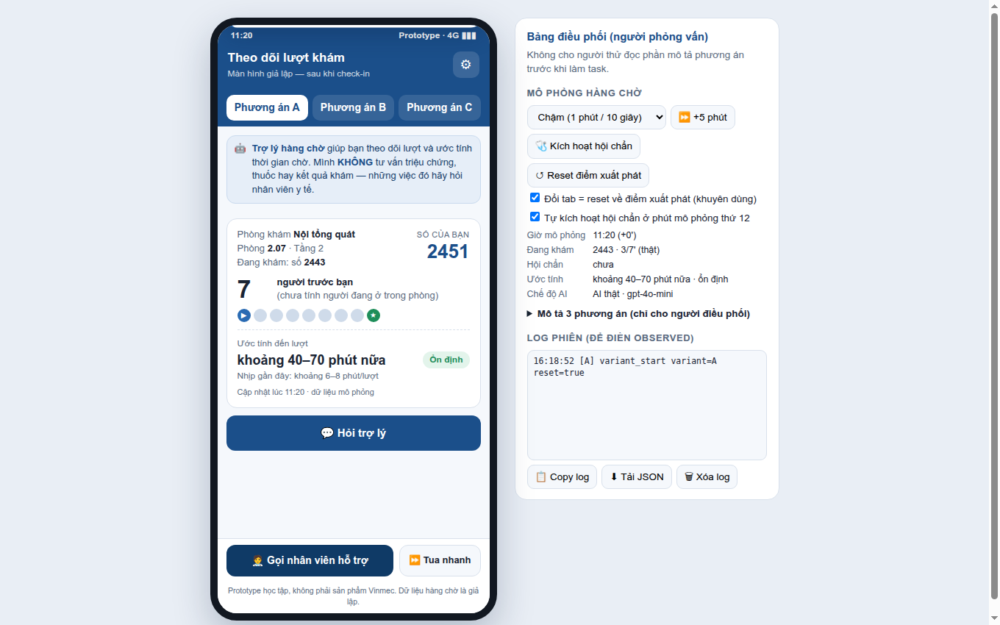

<!-- Slide 1: Tiêu đề -->
<!-- _class: center -->

# Chờ đến lượt khám, người bệnh biết mình đang ở đâu?

Thiết kế trợ lý AI báo tiến độ hàng chờ trên MyVinmec

**Võ Huyền Khánh Mây** · K2 · lab coach, đang làm AI cho bài toán y tế (khóa luận, CarePath)

Bài tập 1 tuần · Vinmec Exploration Sprint

---

<!-- Slide 2: Khoảnh khắc chọn -->
# Khoảnh khắc: chờ đến lượt khám

- Chọn **một** khoảnh khắc, không ôm cả hành trình
- Đây là chỗ người bệnh mất nhiều thời gian nhất, và ít biết chuyện gì đang xảy ra
- Hẹp thì làm sâu được: 3 phỏng vấn, 3 phương án, thử với người thật trong một tuần
- Gần với điều mình thấy ở CarePath: khám chỉ vài phút, phần lớn là chờ

**Sau phỏng vấn, dữ liệu kéo trọng tâm:** ở Vinmec có hẹn, chờ đến lượt đã ổn — sự bất định dồn về **chờ kết quả cận lâm sàng** và hàng chờ dài không có ước tính (viện công)

---

<!-- Slide 3: Method -->
# Mình đã làm gì

- **Dùng thử MyVinmec**, ghi lại làm gì, thấy gì, vướng ở đâu
- **4 phỏng vấn ẩn danh theo Mom Test** (P1–P4, vượt mức ≥3 của đề): hỏi chuyện đã xảy ra, không hỏi ý kiến
- **Journey map** và need statement theo Biodesign
- **Prototype 3 phương án A / B / C** (model GPT, dữ liệu giả lập)
- **Thử với 2–3 người**, ghi log, sửa sau mỗi lượt

---

<!-- Slide 4: Journey map -->
# Journey map và điểm đau

Check-in → chờ gọi tên → khám → cận lâm sàng → **chờ kết quả** → đọc kết quả (chi tiết: `02-journey-map/`)

- 🔴🔴 **Chờ kết quả cận lâm sàng = quãng dài nhất + mù nhất**: "sốt ruột", app không đẩy trạng thái (P1); >2 tiếng, không điều phối, sợ mất chỗ (P4)
- 🔴 **Hàng chờ dài không ước tính** ở viện công: số 800 nhìn bảng 400, tự tính lấy (P2); đến 6h sáng vì 7h hết chỗ ngồi (P4)
- 🔴 **App trống phần "trong buổi khám"**: không check-in, không hàng chờ, không trạng thái kết quả (ghi chép MyVinmec)
- Cảm xúc vẽ theo lời kể; chỗ không có dữ liệu ghi "không có dữ liệu" 

---

<!-- Slide 5: Insight -->
# Insight từ phỏng vấn (OBSERVED)

- **O1 · P2, viện công:** lấy số 8h (bảng ~400, mình ~800) → về nhà, *tự canh thời gian mỗi ca siêu âm rồi nhân lên*, quay lại trúng lượt ~14h. Hệ thống không cho ước tính → người bệnh tự chế công cụ
- **O2 · P1, Vinmec:** điểm khó chịu duy nhất cả buổi = chờ kết quả: *"chờ sốt ruột… mong kết quả cập nhật trước trong phần mềm, nhưng thường cập nhật sau khi kết thúc khám"*
- **O3 · P4, viện công (chờ kết quả >2h, không điều phối):** không rõ đang đến số nào → hỏi bệnh nhân khác, *chỉ rời chỗ khi bắt buộc vì "sợ có người chen trước"*, suýt lỡ lượt; khó chịu nhất = người chen hàng
- **O4 · P3 (đối chứng dương):** bảng hiện số đang khám → tự tính "còn 4 người", yên tâm ngồi — chỉ cần thông tin tối thiểu
- **O5 · P4 so viện tư:** "không gian không hơn mấy… nhưng *đều có người gọi rõ ràng* → không lo mất chỗ"

→ Biến số không phải chờ LÂU, mà là CÓ CƠ CHẾ biết mình ở đâu & ai gọi mình. "Trong 4 cuộc, 3 người kể…" — không nói "validated".

---

<!-- Slide 6: Need statement -->
<!-- _class: center -->

# Need statement

> **Cách để người bệnh ngoại trú biết mình đang ở đâu và còn chờ khoảng bao lâu, vì sao, cho người bệnh đang chờ khám gặp sự bất định về lượt của mình.**

Căn cứ: *"mong muốn kết quả xn và chụp chiếu đc cập nhật trước trong phần mềm hồ sơ"* (P1) · workaround tự canh giờ (P2) · app chưa có phần "trong buổi khám" (ghi chép MyVinmec)

Không nêu giải pháp.

---

<!-- Slide 7: Prototype -->
# Prototype: 3 phương án khác nhau về cơ chế

| | Cơ chế |
|---|---|
| **A user-led** | Người bệnh hỏi, trợ lý trả lời |
| **B proactive** | Trợ lý tự nhắn khi có thay đổi |
| **C collaborative** | Trợ lý gợi ý, người bệnh duyệt rồi mới làm |

- Mọi phương án: hiện **khoảng** thay vì số phút, có nút khẩn cấp cố định
- Dữ liệu giả lập, không có dữ liệu bệnh nhân thật

---

<!-- Slide 8: Kết quả thử -->
# Thử với người dùng và mình sửa gì

Thiết kế thử: 5 nhịp (comfort → context → task → observe → compare), người thử tự cầm máy, task theo đích: *"quyết định xem bạn có kịp đi ăn trưa không"* — AI thật (gpt-4o-mini), log máy tự ghi

**T1** (nữ 18-24, không trùng P1–P4): chọn **C** "vì custom được"; *thử lại ước tính bằng con số của mình* ("nếu ăn 10p thì sao?") rồi mới quyết đi ăn — đúng hành vi cần cho trust

**Prototype sai 2 chỗ → đã sửa (prompt v2 + logic):**
- 🔴 Khối khẩn cấp bắn nhầm 3 lần: "**ko có** bị khó thở" vẫn kích cảnh báo → thêm lọc phủ định trước từ khóa
- 🔴 AI **hứa** "nhắc khi còn 6 người" nhưng cơ chế vẫn nổ ở mốc 3 → app parse ngưỡng thật, cấm model hứa thay hệ thống
- Bot tự giả định "đi ăn 40 phút" → chưa biết thời lượng thì phải hỏi lại; khoảng ±30' và nhãn "dao động" phải hỏi mới hiểu

Giới hạn: mới n=1, quyết định thiết kế tiếp theo chứ **không phải "validated"**; cần thêm người lớn tuổi (T1 dự đoán "người lớn chọn B" — chưa kiểm chứng)

---

<!-- Slide 9: Best practice + rủi ro -->
# Bài học cho Vinmec và rủi ro chính

**Best practice quốc tế** (nguồn trong `04-best-practice/`)
- **SingHealth Health Buddy** (Singapore): số người trước mình, cập nhật ~5 phút → minh bạch vị trí hàng chờ là làm được ở quy mô hệ thống
- **Maister, *Psychology of Waiting Lines***: chờ không lời giải thích dài hơn chờ được giải thích — khớp O4
- **RCT Alrajhi 2020**: riêng việc báo số phút chưa chắc tăng hài lòng (p=0.476) nhưng 70% người bệnh vẫn muốn có — đừng hứa số chính xác, hãy cho khoảng + lý do

**Rủi ro chính, cách giảm**
- Báo thừa giờ thì người bệnh đi xa, lỡ lượt: hiện **khoảng, thiên dè dặt**, không số giả chính xác
- Hỏi triệu chứng: từ chối và chuyển người thật; từ khoá khẩn cấp hiện **khối đỏ** + vị trí quầy
- Người không dùng app: bảng gọi số và nhân viên vẫn giữ song song
- Dữ liệu: bản thử chỉ mock; bản thật không gửi thông tin định danh vào API bên thứ ba

---

<!-- Slide 10: 6 tuần + coach -->
# Nếu có 6 tuần ở Vinmec, và mình coach K4 thế nào

**Mình làm tiếp (Tuần 1–6)**
- Quan sát và phỏng vấn ngay tại khoa, thêm điều dưỡng và nhân viên quầy
- Đo thời gian chờ thật (khử định danh) để kiểm tra ước tính
- Thử vòng 1 và 2 với người dùng Vinmec; đo lỡ lượt, không chỉ "hài lòng"

**Mình coach K4**
- Kickoff thứ Hai chốt khoảnh khắc và "thế nào là xong"; thứ Tư kiểm log thật; thứ Sáu checkpoint
- Hỏi thay vì đưa đáp án; chấm chéo theo mẫu feedback có dòng cụ thể (từ đội QA 12 người)
- Soi trích dẫn tròn trịa và log toàn lời khen
